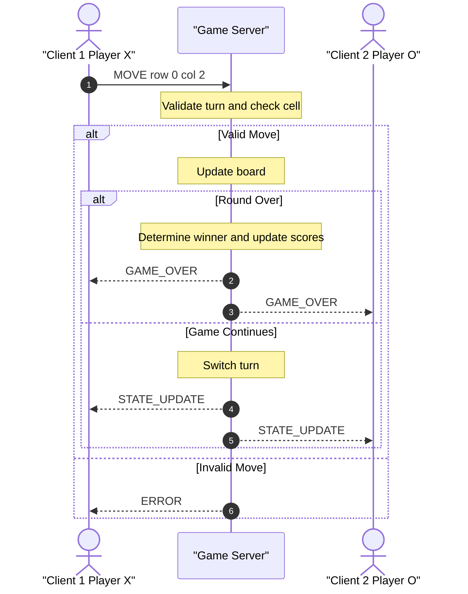

# Sprint 2 - Game Behavior & Server Concurrency Architecture Design

## 1. Server Concurrency Model

For the game server, I chose non-blocking I/O multiplexing using Python's `selectors` module.

The server will use one main event loop instead of creating a separate thread for every client. Each client socket will be placed into non-blocking mode using `setblocking(False)` and registered with the selector.

The selector will watch all connected client sockets and check which ones are ready to read or write. This allows the server to handle multiple clients without one client blocking the entire server while waiting for data.

For this game, the server needs to support at least two clients at the same time because Player X and Player O must both stay connected during the game.

## 2. Connection Lifecycle

The server connection process will work like this:

1. The server creates a listening socket.
2. The listening socket is placed into non-blocking mode.
3. The listening socket is registered with the selector.
4. When a client connects, the server accepts the connection.
5. The new client socket is also placed into non-blocking mode.
6. The client socket is registered with the selector for read and write events.
7. The server event loop checks for sockets that are ready.
8. When a client sends a message, the server reads and processes it.
9. When the server needs to send information back, the response is sent when that socket is ready for writing.
10. If a client disconnects, the server unregisters the socket from the selector and closes the connection.

This allows the server to continue working with the other connected player even while it is waiting for activity from one client.

## 3. Game State and State Isolation

The main game state will be stored on the server. The server will be the authority for deciding whether moves are valid and what the current game state is.

The server will keep track of shared information such as:

- The game board
- The active player's turn
- Player X's connection
- Player O's connection
- Player X's score
- Player O's score
- Whether the current round is finished

Because this design uses a single-threaded selector event loop, only one event handler changes the game state at a time.

This means I do not need to use `threading.Lock` for this design. There are not multiple server threads changing the board, turn, or scores at the same exact time.

The server finishes processing one state-changing event before moving on to another event. This prevents two clients from changing the board at the same time and helps prevent race conditions.

## 4. Move Validation and Turn Enforcement

When a client sends a move, the server will validate the move before changing the board.

The server will check:

1. Which player sent the move.
2. Whether it is that player's turn.
3. Whether the requested board position is valid.
4. Whether the selected cell is empty.
5. Whether the round has already ended.

If the move is valid, the server updates the board and switches the active turn to the other player.

The updated state is then sent to both clients so that both players have the same copy of the board and know whose turn is next.

If the move is invalid or a player tries to move out of turn, the server does not change the game state. Instead, it sends an error message back to the client that made the invalid request.

## 5. State Broadcast Design

After every valid move that does not end the round, the server creates a `STATE_UPDATE` message.

If the move ends the round, the server sends a `GAME_OVER` message to both clients instead.

The update contains the current board and the active player's turn.

The server sends the same state update to both connected clients. This keeps Player X and Player O synchronized with the server.

With non-blocking sockets, the update can be placed in each client's outgoing data buffer. The selector sends the data when each client's socket is ready for writing.

Both clients receive the same authoritative game state before another move is allowed to change the game state.

## 6. Score and Leaderboard Synchronization

The server will also keep the player scores in memory.

For example, the server can store the scores using values similar to:

- Player X score
- Player O score

When a round ends, the server determines the winner before changing the scores.

If Player X wins, Player X's score is increased.

If Player O wins, Player O's score is increased.

If the round is a draw, neither player's win score is increased.

After the score is updated, the server sends the updated score information to both clients.

This makes sure both clients display the same scores and leaderboard information.

The server remains the authority for the scores, so clients cannot directly change their own score.

## 7. Turn and Score Synchronization Sequence Diagram

